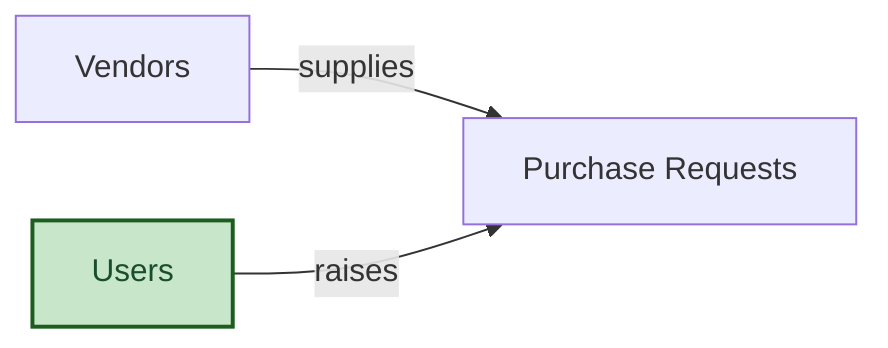

# Purchase Requests

## 1. Overview

Staff raise purchase requests against approved vendors. A budget owner approves the spend before purchasing places the order, and only some people may add a new vendor.

## 2. Entity summary

| Name | data_object | Description |
| --- | --- | --- |
| Purchase Requests | `purchase_requests` | A request to buy goods or services from a vendor. Created when a staff member needs a purchase. |
| Vendors | `vendors` | A supplier the team may buy from. Created when a supplier is onboarded. |

## 3. Entities catalog

| # | data_object | catalog code | singular | plural | held_as | mastered in | mastered label | install_optional | entity_type | write tier | notes |
| ---: | --- | --- | --- | --- | --- | --- | --- | --- | --- | --- | --- |
| 1 | `purchase_requests` | `purchase_requests` | Purchase Request | Purchase Requests | master | - | - | - | operational_workflow | `:manage` | - |
| 2 | `vendors` | `vendors` | Vendor | Vendors | master | - | - | - | operational_record | `:manage` | Adding a vendor is a restricted step |

## 4. Aliases and industry synonyms

_(none: no industry-scoped aliases for this scope)_

## 5. Relationships

_`field_required` applies only when both entities are installed. It never makes an entity required._

### 5.1 Relationships between entities in this blueprint

| from | verb | to | cardinality | kind | field_required | delete_mode | fk_format | notes |
| --- | --- | --- | --- | --- | --- | --- | --- | --- |
| `vendors` | supplies | `purchase_requests` | one_to_many | reference | yes | restrict | reference | - |

### 5.2 Relationships to platform built-ins (`users`)

| from | verb | to | cardinality | field_required | delete_mode | fk_format | notes |
| --- | --- | --- | --- | --- | --- | --- | --- |
| `users` | raises | `purchase_requests` | one_to_many | yes | restrict | reference | - |

### 5.3 Relationships to entities outside this blueprint

_External entities are optional: this blueprint never installs them. If one exists at install, the relationship is proposed. A many-to-many relationship is listed under outgoing and proposed as a new junction table._

#### 5.3a Outgoing relationships: this blueprint's entity points to the external entity

_(none: greenfield module, no external relationships requested)_

#### 5.3b Incoming relationships: the external entity points to this blueprint's entity

_(none: greenfield module, no external relationships requested)_

## 6. Cross-domain context

### 6.1 Master consumers (other modules / domains that embed this scope's masters)

_(none: no other module embeds this scope's masters)_

### 6.2 Outbound handoffs (events this scope publishes)

_(none: no outbound handoffs requested)_

### 6.3 Inbound handoffs (events this scope reacts to)

_(none: no inbound handoffs requested)_

### 6.4 Master providers (modules / domains that own masters this scope embeds)

_(none: every entity is mastered here)_

## 7. Lifecycle states (per master)

### `purchase_requests` (Purchase Request)

| order | state_name | initial? | terminal? | requires_permission? | high risk? | derived gate | description |
| ---: | --- | :---: | :---: | :---: | :---: | --- | --- |
| 1 | `draft` | ✓ | - | - | - | - | The requester is still writing the request. |
| 2 | `submitted` | - | - | - | - | - | Sent to the budget owner for approval. |
| 3 | `approved` | - | - | ✓ | ✓ | `purchase-requests:approve_purchase_request` | The budget owner approved the spend. |
| 4 | `ordered` | - | - | ✓ | yes | `purchase-requests:order_purchase_request` | Purchasing placed the order with the vendor. |
| 5 | `closed` | - | ✓ | - | - | - | The goods or services were received. |
| 6 | `rejected` | - | ✓ | - | ✓ | - | The budget owner declined the spend. |

## 8. Permissions and business rules (derived)

### 8.1 Permissions

| permission | tier | description | included in `:admin`? |
| --- | --- | --- | --- |
| `purchase-requests:read` | baseline-read | Read access to every entity in the module | ✓ |
| `purchase-requests:manage` | baseline-manage | Edit operational records | ✓ |
| `purchase-requests:admin` | baseline-admin | Edit reference data and take every process gate | - |
| `purchase-requests:approve_purchase_request` | workflow-gate (lifecycle) | Transition `purchase_requests` into state `approved` | ✓ |
| `purchase-requests:order_purchase_request` | workflow-gate (lifecycle) | Transition `purchase_requests` into state `ordered` | ✓ |
| `purchase-requests:create_vendor` | workflow-gate (lifecycle) | Create a `vendors` record | ✓ |

### 8.2 Business rules

| rule_name | data_object | source flag | intent |
| --- | --- | --- | --- |
| `purchase_request_approval_gate` | `purchase_requests` | lifecycle | Moving a request into `approved` needs the approval gate. |
| `purchase_request_order_gate` | `purchase_requests` | lifecycle | Moving a request into `ordered` needs the order gate. |
| `vendor_creation_gate` | `vendors` | create | Adding a vendor needs the vendor creation gate. |

## 9. Roles, RACI, and responsibilities (derived)

### 9.1 `PURCHASE-REQUESTS`

**Baseline roles:**

| role | baseline grant |
| --- | --- |
| `purchase_requests_viewer` | `purchase-requests:read` |
| `purchase_requests_manager` | `purchase-requests:manage` |
| `purchase_requests_admin` | `purchase-requests:admin` |

**Permission hierarchy:**

| permission | includes |
| --- | --- |
| `purchase-requests:admin` | `purchase-requests:manage` |
| `purchase-requests:manage` | `purchase-requests:read` |
| `purchase-requests:admin` | `purchase-requests:approve_purchase_request` |
| `purchase-requests:admin` | `purchase-requests:order_purchase_request` |
| `purchase-requests:admin` | `purchase-requests:create_vendor` |
