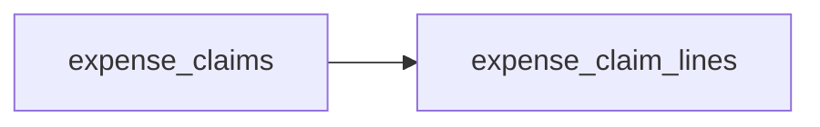

# Expense Claims: Semantic Model

## 1. Overview

Staff claim back business expenses. An approver signs off each claim before finance pays it, and an auditor can dispute a single line.

## 2. Entity summary

| # | Table name | Singular label | Purpose |
|---|---|---|---|
| 1 | `expense_claims` | Expense Claim | A request to be paid back for business expenses. |
| 2 | `expense_claim_lines` | Expense Claim Line | One expense on a claim. |

### Entity-relationship diagram



## 3. Entities

### 3.1 `expense_claims` - Expense Claim

**Plural label:** Expense Claims
**Label column:** `claim_number`
**Audit log:** yes
**Catalog entity code:** `expense_claims`
**Entity type:** operational_workflow
**Description:** A request to be paid back for business expenses. Created when a staff member submits receipts.

**Fields**

| Field name | Format | Required | Label | Description | Reference / Notes |
|---|---|---|---|---|---|
| `claim_number` | `string` | yes | Claim Number | | `label_column`, `unique` |
| `workflow_state` | `enum` | yes | Status | | enum_values: `draft`, `submitted`, `approved`, `paid`; default: "draft" |
| `total_amount` | `number` | no | Total Amount | Sum of the claim lines. | precision: 2 |

**Relationships**

- An `expense_claims` record may have many `expense_claim_lines` (1:N, via `expense_claim_lines.expense_claim_id`).

**Validation rules**

```json
[
  {
    "code": "99001",
    "name": "approve_needs_gate",
    "message": "Only an admin can approve an expense claim.",
    "description": "Approving is a process gate.",
    "jsonlogic": {"if": [
      {"and": [{"value_changed": "workflow_state"}, {"==": [{"var": "workflow_state"}, "approved"]}]},
      {"has_permission": "expense-claims:approve_expense_claim"},
      true]}
  },
  {
    "code": "99002",
    "name": "pay_needs_gate",
    "message": "Only an admin can mark an expense claim paid.",
    "description": "Paying is a process gate.",
    "jsonlogic": {"if": [
      {"and": [{"value_changed": "workflow_state"}, {"==": [{"var": "workflow_state"}, "paid"]}]},
      {"has_permission": "expense-claims:pay_expense_claim"},
      true]}
  }
]
```

### 3.2 `expense_claim_lines` - Expense Claim Line

**Plural label:** Expense Claim Lines
**Label column:** `line_description`
**Audit log:** no
**Catalog entity code:** `expense_claim_lines`
**Entity type:** operational_workflow
**Description:** One expense on a claim. Created with the claim it belongs to.

**Fields**

| Field name | Format | Required | Label | Description | Reference / Notes |
|---|---|---|---|---|---|
| `line_description` | `string` | yes | Description | | `label_column` |
| `expense_claim_id` | `parent` | yes | Expense Claim | | ↳ `expense_claims` (N:1) |
| `workflow_state` | `enum` | yes | Status | | enum_values: `open`, `disputed`, `resolved`; default: "open" |
| `amount` | `number` | yes | Amount | | precision: 2 |

**Relationships**

- An `expense_claim_lines` record belongs to one `expense_claims` via `expense_claim_id` (N:1, required, cascade on delete).

**Validation rules**

```json
[
  {
    "code": "99003",
    "name": "dispute_needs_gate",
    "message": "Only an admin can dispute an expense claim line.",
    "description": "Disputing is a process gate.",
    "jsonlogic": {"if": [
      {"and": [{"value_changed": "workflow_state"}, {"==": [{"var": "workflow_state"}, "disputed"]}]},
      {"has_permission": "expense-claims:dispute_expense_claim_line"},
      true]}
  }
]
```

---

## 4. Relationship summary

| From | Field | To | Cardinality | Kind | fk_format | Delete behavior |
|---|---|---|---|---|---|---|
| `expense_claim_lines` | `expense_claim_id` | `expense_claims` | N:1 | parent | parent | cascade |

## 5. Enumerations

### `expense_claims.workflow_state`
- `draft`
  - label: Draft
  - color: `#94a3b8`
- `submitted`
  - label: Submitted
  - color: `#3b82f6`
- `approved`
  - label: Approved
  - color: `#22c55e`
- `paid`
  - label: Paid
  - color: `#15803d`

### `expense_claim_lines.workflow_state`
- `open`
  - label: Open
  - color: `#94a3b8`
- `disputed`
  - label: Disputed
  - color: `#f97316`
- `resolved`
  - label: Resolved
  - color: `#22c55e`

## 6. Cross-model relationship suggestions

_(none: no cross-module relationships)_

### Outbound handoffs

_(none: no outbound handoffs)_

### Inbound handoffs

_(none: no inbound handoffs)_

## 7. Open questions

### 7.1 🔴 Decisions needed (blockers)

_(none: nothing blocks deployment)_

### 7.2 🟡 Future considerations (deferred scope)

_(none: no deferred scope)_

## 8.1 Permissions catalog

| permission | tier | description | included in `:admin`? | reconciliation |
| --- | --- | --- | --- | --- |
| `expense-claims:read` | baseline-read | Read access to every record in the module. | ✓ | (none) |
| `expense-claims:manage` | baseline-manage | Create and edit records in the module. | ✓ | (none) |
| `expense-claims:admin` | baseline-admin | Administer the module and take every process gate. | - | (none) |
| `expense-claims:approve_expense_claim` | workflow-gate (lifecycle) | Transition `expense_claims` into state `approved`. | ✓ | (none) |
| `expense-claims:pay_expense_claim` | workflow-gate (lifecycle) | Transition `expense_claims` into state `paid`. | - | (none) |
| `expense-claims:dispute_expense_claim_line` | workflow-gate (lifecycle) | Transition `expense_claim_lines` into state `disputed`. | ✓ | (none) |

## 8.2 Business rules

| rule_name | data_object | source flag | intent |
| --- | --- | --- | --- |
| `approve_needs_gate` | `expense_claims` | `lifecycle` | Moving a claim into `approved` needs the approval gate. |
| `pay_needs_gate` | `expense_claims` | `lifecycle` | Moving a claim into `paid` needs the payment gate. |
| `dispute_needs_gate` | `expense_claim_lines` | `lifecycle` | Moving a line into `disputed` needs the dispute gate. |

## 9. Governance

### 9.1 `EXPENSE-CLAIMS`

**Baseline roles:**

| role | baseline grant | reconciliation |
| --- | --- | --- |
| `expense_claims_viewer` | `expense-claims:read` | ✨ to create |
| `expense_claims_manager` | `expense-claims:manage` | ✨ to create |
| `expense_claims_admin` | `expense-claims:admin` | ✨ to create |

**Permission hierarchy:**

| permission | includes | reconciliation |
| --- | --- | --- |
| `expense-claims:admin` | `expense-claims:manage` | ✨ to create |
| `expense-claims:manage` | `expense-claims:read` | ✨ to create |
| `expense-claims:admin` | `expense-claims:approve_expense_claim` | ✨ to create |

**Processes:** _(none: access_scope is gated, no Processes catalog is authored)_

### 9.2 Functional ownership and default grants

| responsibility | business function | default role | default tier |
| --- | --- | --- | --- |
| owner | Finance | `admin` | `:admin` |
