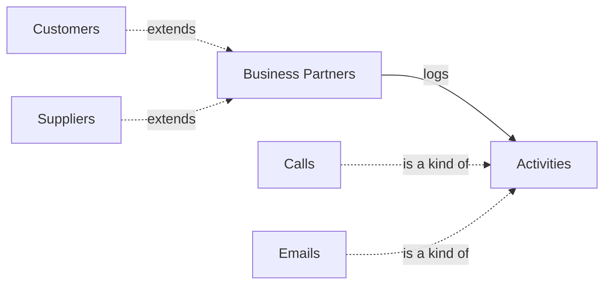

# Semantic Blueprint Template

Use this template verbatim for the final semantic-blueprint output the architect produces. Each `{{placeholder}}` is replaced with the value gathered during the workflow.

The blueprint is **platform-agnostic and entity-level only**. No fields. No JsonLogic. No DDL. The downstream `semantius-analyst` skill takes this blueprint, reconciles it against the live Semantius catalog, and produces a `*-semantic-spec.md` that carries the field-level detail.

Keep the section order and the table columns identical, downstream skills parse by header.

---

## Template starts below this line

````markdown
---
artifact: semantic-blueprint
version: "3.1"
naming_mode: {{template:<vendor> | agent-optimized — greenfield only; omit in catalog-clone files}}
license: {{license slug, e.g. MIT}}
system_name: {{System display name shown to the user AND used as the module name — keep acronyms as acronyms (CRM, ITSM, CMDB)}}
icon_name: {{Module icon: a Lucide icon name in kebab-case or an icon URL, e.g. briefcase, users, circle-question-mark}}
tagline: {{One-line marketing-voice line for catalog / card surfaces, ALSO used as the module record's short description (modules.description) shown beside the name in the selector. Elevator pitch — keep it concise enough for the chip.}}
description: {{Longer marketing-voice prose for the catalog page (1-3 paragraphs). Reads to a buyer, not to the analyst. Multi-line YAML block (|) is fine.}}
system_slug: {{system_slug_kebab_case}}
domain_modules:
  - {{system_slug}}
domain_code: {{TLA code, e.g. ATS, HCM, ITSM, CRM}}
related_modules: [{{slug_1, slug_2, ...}}]
persona: [{{PERSONA-1, PERSONA-2, ...}}]
module_kind: {{starter | master | domain — informational label, NOT a behavior switch}}
access_scope: {{custom | basic | advanced | gated | raci}}
supports_raci: {{true | false}}
raci_mode: {{living | documentation — OPTIONAL hint, read by the analyst's existing RACI-mode derivation; only meaningful when access_scope: raci}}
created_at: {{YYYY-MM-DD}}
initial_request: |
  {{verbatim Stage 1 opening request}}
---

# {{System display name}}

## 1. Overview

{{Two or three sentences describing the system, its users, and the problem it solves. Catalog-readable narrative — downstream skills copy this verbatim into human-facing READMEs. Hard bans: no §-number cross-references (no "see §6"); no snake_case identifiers (no `cost_center_id`); no platform plumbing words ("Semantius", "deployer", "deploy time", "self-contained"); no scope-deferral or authoring-decision narration ("deliberately out of scope", "moved to a sibling domain"). Deferrals live in `related_modules` plus §6, never in §1 prose.}}

## 2. Entity summary

**Entity order (canonical).** Sequence entities by their §3 `entity_type` tier, then alphabetically by `data_object` within each tier: (1) `catalog` masters/lookups, (2) `operational_record` / `operational_workflow` / `computed` / `unclassified`, (3) `junction`, then (4) platform built-ins (`users`, …) last. Use this exact order in this §2 table, the Mermaid nodes, and the §3 catalog. It is deterministic from `entity_type` + `data_object` alone, so the analyst's spec and the reverse pass (`semantius-optimizer`) reproduce the same order; never order by discovery or authoring convenience.

| Name | data_object | Description |
| --- | --- | --- |
| {{Plural Label 1}} | `{{table_name_1}}` | {{1-2 sentence description of what a record represents and when it's created — the authoritative deployed text; see column rules}} |
| {{Plural Label 2}} | `{{table_name_2}}` | … |

**Column rules:** `Name` is the entity's **plural** display label and MUST equal the §3 `plural` column byte-for-byte. `data_object` is the bare backticked `table_name` (lower snake_case `[a-z][a-z0-9_]*`, no parenthesized label) and MUST equal the §3 `data_object`. The Mermaid node label below also uses the **plural** label. `Description` is the entity's **single authoritative, deploy-quality description** (1-2 sentences: what a record represents and when it's created). It is the sole source of truth for this text across the whole pipeline: the analyst carries it **verbatim** into the spec's §3 `**Description:**` and derives the §2 Purpose one-liner from its first sentence, and the modeler deploys it to `entities.description` (the text users see in the product). So write the real product-facing description here, not a bare field-list — what you write is what ships. Downstream stages do not re-author it.

```mermaid
flowchart LR
  classDef builtin fill:#c8e6c9,stroke:#1b5e20,stroke-width:2px,color:#1a4d2e;
  classDef master fill:#d4f4dd,stroke:#27ae60,color:#1a4d2e;
  {{table_name_1}}["{{Plural Label 1}}"]
  {{table_name_2}}["{{Plural Label 2}}"]
  users["Users"]
  {{table_name_1}} -->|"{{verb}}"| {{table_name_2}}
  users -->|"holds"| {{table_name_1}}
  class {{table_name_1}} master;
  class users builtin;
```

**Classes used by the diagram** (the same as Stage 5, `stage-5-mermaid.md`):

- **`builtin`** — platform built-ins the module reuses (`users`, `roles`, `permissions`). Always reused; never created.
- **`master`** — entities carrying a `**Shared master cluster:** <cluster>` annotation in §3: created here by default, and the deployer may offer to host them in a shared master module.

All other entities render with default styling. Omit a `classDef` and its `class` lines when no entity qualifies.

**Cardinality conventions:**

| Cardinality | Syntax | Reads as |
| --- | --- | --- |
| one-to-many | `A --> B` | A has many B |
| one-to-one | `A --- B` | A has one B |
| many-to-many | one `-->` edge for a `many_to_many` row; two `-->` edges via a junction entity listed in §3 | both sides hold many junction rows |
| Labeled | `A -->|verb| B` | diagram edge carries the relationship verb |
| Family (dotted, not a §5 row) | `A -.->|"is a kind of"| B` / `A -.->|"extends"| B` | A is an `is_a` / `has_a` entity based on B |

A junction entity listed in §3 gets its own node with two `-->` edges in from the parents. A `many_to_many` §5 row with no junction entity is drawn as one direct diagram edge that matches the row, because the junction does not exist until the analyst creates it.

**Diagram edge labels are managed metadata, not free guesses.** Every diagram edge carries a verb drawn from §5 (the verb column). The diagram and §5 must agree byte-for-byte, so the §5 `verb` cell is plain text, never backticked (`logs`, not `` `logs` ``); only the `from` / `to` identifiers are backticked.

**Platform built-ins in the diagram.** A built-in the module has a relationship to (`users`) is listed in §3 (`_(platform built-in)_` in `mastered in`) and drawn as a node (`users["Users"]`, `class users builtin;`); `consistency-check.ts` accepts built-in nodes and diagram edges.

**Family diagram edges.** Each §3 `**Key types:**` row with a `based on` draws one dotted edge **from the based entity to its base**, with a fixed verb: `"is a kind of"` for `is_a`, `"extends"` for `has_a`. They are not §5 rows; `consistency-check.ts` compares them with the Key types rows in both directions, and `consistency-check.ts --emit-mermaid <blueprint>` prints them. A relationship every kind shares is **one §5.1 row from the base**, never one row per kind. Worked fragment (companies kept once, activities on one timeline):



Here `business_partners -->|"logs"| activities` is the single §5.1 row; there is no `customers -->|"logs"| activities` or `calls` row.

## Additional Requirements Specification

_**OPTIONAL, omit this heading entirely when unused** (the normal case). This is the one sanctioned exception to the "no field-level content" rule: a free-prose channel for a requirement the analyst MUST honor to build a correct spec but CANNOT derive from the entity-level structure (a specific field a cost / rollup view depends on, a fixed unit or currency, a cross-module denormalization-and-dedup rule, an externally-mandated value). It is omit-when-empty (like the §3 per-entity sub-blocks), NOT a canonical keep-with-placeholder section, so never write a `_(none: …)_` placeholder here._

_**Placement:** immediately after §2 and before §3, at the seam where the human-readable orientation (Overview, entity summary, diagram) ends and the structured sections begin. Keeping it out of §1 / §2 leaves the human-readable block intact._

_**Audience and register:** the downstream skills, not a human reviewer. The architect preserves it on clone / customize and may author it on greenfield; the analyst consumes it during field elicitation. Write in compact technical register, backticked `table_name` / `field_name` identifiers are expected, and Writing Conventions 6 and 8 (no identifier leakage / plain language) do NOT apply here. Conventions 1 (US English) and 2 (no em-dash) still do._

{{Free prose. Name entities and fields by their `data_object` / field identifiers; for each requirement state what is needed and WHY it cannot be derived (what breaks downstream if ignored). Keep it to genuine non-derivable requirements, do NOT restate fields the analyst would obviously draft, and do NOT turn this into a parallel field table, which re-imports the field-level content the entity-only split exists to remove.}}

## 3. Entities catalog

| # | data_object | catalog code | singular | plural | held_as | mastered in | mastered label | install_optional | personal_content | entity_type | write tier | notes |
| ---: | --- | --- | --- | --- | --- | --- | --- | --- | --- | --- | --- | --- |
| 1 | `{{table_name}}` | `{{catalog_code}}` | {{Singular Label}} | {{Plural Label}} | master \| embedded_master \| contributor \| consumer | `-` (this module owns) \| `<other_module_slug>` | `-` (this module owns) \| {{Display name of owner module}} | yes \| - | yes \| - | operational_workflow \| operational_record \| catalog \| junction \| computed | `:manage` \| `:admin` \| `:read` \| `:manage` _(pending)_ \| `:{{narrow}}` | {{optional one-liner}} |
| 2 | … | … | … | … | … | … | … | … | … | … | … |

**Column rules:**

- **`data_object`** — the backticked snake_case `table_name` and **nothing else** (no parenthesized label). Lower snake_case matching `[a-z][a-z0-9_]*`, always the plural form for the table name (`candidates`, not `candidate`); Semantius requirement. This is the **local / dialect** name the entity deploys under. Must equal this entity's §2 `data_object` byte-for-byte.
- **`catalog code`** — the entity's **catalog uber-model code**: the stable design-time identity, lower snake_case plural, backticked. This is the lineage carrier the analyst threads through to the spec and the deployer stamps into `entities.catalog_entity_code` (NOT the deployed `table_name`, which lives in `data_object` / `entities.table_name` and may drift). **Agent-optimized self-describing naming: catalog = local** — set `catalog code` equal to `data_object`. When the deployed `data_object` is a **vendor dialect** (`accounts` for canonical `customers`) or a **silo rename** (`erp_vendors` for canonical `vendors`), `catalog code` carries the catalog concept and `data_object` the deployed name. Stamp the catalog code only when the entity maps to a recognized uber-model concept you can name confidently; otherwise default `catalog code = data_object` (never invent a catalog name). Catalog-clones inherit the source slice's catalog code. The deployer treats it as write-once identity, so a later rename touches `table_name` only, never this code.
- **`singular`** — the entity's **singular** display label (e.g. `Candidate`). Must equal the parenthetical in this entity's §7 lifecycle heading byte-for-byte. Maps to the platform's `entities.singular_label`.
- **`plural`** — the entity's **plural** display label (e.g. `Candidates`). Must equal the §2 `Name` column and the §2 Mermaid node label byte-for-byte. Maps to the platform's `entities.plural_label`.
- **`held_as`** — how this module holds the entity. One of:
  - `master`: this module is the catalog owner of the entity; lifecycle defined in §7. Only the catalog owner module declares `master`.
  - `embedded_master`: this module needs the entity self-contained today, but a different module is the *intended* catalog owner (named in `mastered in`). Until that owner is installed, this module hosts the entity; once the owner installs, the entity migrates automatically without data movement. Use when the blueprint stands alone but expects a future master. Example: `candidates` in `hiring-starter` with `mastered in: ats-candidate-crm`.
  - `contributor`: mastered elsewhere (per `mastered in`) but participates in this module's workflows. The analyst wires reuse-from at deploy time. Example: `skill_profiles` in `ats-candidate-crm` with `mastered in: lms-skills`.
  - `consumer`: read by this module; never written here. Example: `career_aspirations` (read-only reference from another module).
  - `derived`: carried only from the catalog, never authored here. The module republishes signals it computes from other modules' masters (People Analytics reading `employees`); `mastered in` names the entity's catalog master, and is `-` only when the catalog has none, in which case the entity gets no permission rows here. `consistency-check.ts` accepts exactly these five values.
- **`mastered in`** — `-` when this module owns the entity (`held_as` = `master`), or on a `derived` row whose entity has no master in the catalog. Otherwise, the kebab-case slug of the catalog owner module (`ats-candidate-crm`, `lms-skills`, `talent-succession-career`). For `embedded_master`, this names the *future* owner. The entity's permissions carry this slug as their prefix (§8.1), whether or not that module is installed.
- **`mastered label`** — `-` when `mastered in` is `-`. Otherwise, the human-readable display name of the **owning module** (`Candidate CRM`, `Skills and Learning Paths`, `Succession and Career Planning`). It names the owner module, NOT this entity (the entity's own labels are the `singular` / `plural` columns); the analyst uses it in user-facing prompts so users don't see raw slugs. For platform built-ins (`users`, `roles`), use `_(platform built-in)_` in both `mastered in` and `mastered label`.
- **`install_optional`**: `yes` when the module can be installed without this entity, `-` (the default) otherwise. Install-optional entities are presented to the user during reconciliation; the user picks which to include. Common candidates: `locations` (some orgs have one), `cost_centers` (some orgs don't track), `tags` (nice-to-have). This column says nothing about a relationship's field: that is the §5 `field_required` column.
- **`personal_content`**: `yes` when the entity's records hold personal data, `-` otherwise. It drives the `override (personal_content)` rows in §8.1.
- **(behavior flags removed)**: row-scope visibility, field locks, and approval requirements are **not** §3 columns. Approvals are gated lifecycle transitions (§7 `requires_permission?`; under `gated` and `raci` also the matching §8.1 `workflow-gate`) and/or §9 RACI. Row-scope and field-lock rules are authored by the analyst as field-level JsonLogic (`select_rule` / `validation_rules`) during reconciliation; when a specific row-scope requirement is known up front and cannot be derived, state it in the **Additional Requirements Specification** section (e.g. *"`user_bookmarks` is private to its creator; scope on `created_by`"*).
- **`entity_type`** — the entity's **data-class axis**, mirroring the closed upstream `data_objects.entity_type` set: one of `operational_workflow`, `operational_record`, `catalog`, `junction`, `computed` (the sixth value `unclassified` is the platform's empty default and is **not** authored here — emit a concrete class). This is the **primary classification**: `write tier` derives FROM it, never the reverse. Sourced from Stage 9 (carry-forward from the upstream `data_objects` value for catalog-clones when it is classified; otherwise derive with the `use-semantius` ladder via Stage 9, reading §5 for junctions and §7 for workflow-vs-record). Maps to the platform's `entities.entity_type`. The set is **closed** — never coin a value outside it.
- **`write tier`** — which of this module's bundles includes the entity's write permission, `<owner>:write_<entity>` (§9.1), **DERIVED from `entity_type`** (do not classify the tier independently) by the `use-semantius` tier table (`data-modeling.md` → "Classifying an entity"). One of `:manage` (operational, default), `:admin` (reference / config), `:read` (computed / read-only: no write permission), `:manage` _(pending)_ when the tier depends on what gets installed (`embedded_master` rows whose catalog owner isn't yet present and may shift the tier), or a narrow suffix (`:interview`) naming a §8.1 `narrow` row, when external participants write the entity. Consumed by the analyst verbatim (the analyst does not re-derive the tier — it validates against the live catalog and emits drift only).

**Key types:**

| data_object | key type | key prefix | based on |
| --- | --- | --- | --- |
| `{{table_name}}` | bigint \| text \| uuid \| typeid \| is_a \| has_a | {{prefix, typeid and is_a only}} \| `-` | `{{base table_name}}` (is_a / has_a only) \| `-` |

**Key types rules:** OPTIONAL and omit-when-empty (like the Additional Requirements Specification): write the `**Key types:**` caption and table only when at least one entity uses a key other than the default, and list **only** those entities; an entity with no row gets the default `auto_increment` (sequential numbers the database assigns). Never write a `_(none: …)_` placeholder here. Catalog-clones and customize runs inherit the source's rows and adjust them like any inherited section; Stage 3 (`stage-3-entities.md`, "Key type") has the decision rule, and [`normalization.md`](normalization.md) decides families. Parsed by header: the legacy 3-column form (no `based on`) stays valid. All rules below are enforced by `consistency-check.ts`.

- **`data_object`** — a §3 row this module provisions (`master` / `embedded_master`); contributor, consumer, and built-in entities keep their owner's key and are never listed.
- **`key type`** — bare value: `typeid` (prefixed, sortable ids such as `acct_01h455vb4pex5vsknk084sn02q`, the choice for ids users or other systems see: in links, emails, support conversations, integrations), `uuid` (globally unique, no prefix), `bigint` / `text` (the caller supplies the id on every insert; only for records mirrored from an external system whose ids must be kept), `is_a` (a kind of the `based on` entity, fixed at creation; its records share the base's key and appear in the base's list), `has_a` (something a `based on` record can also be; it shares that record's key). Internal tables keep the default. Never `computed` (system tables only). The key type is **locked once the entity is deployed**, so decide it here: changing it later means rebuilding the entity.
- **`key prefix`** — bare value, required for `typeid` and `is_a` and `-` otherwise (`has_a` uses its base's prefix): lower-case letters and underscores, starting and ending with a letter, at most 63 characters (`^[a-z](?:[a-z_]{0,61}[a-z])?$`); written without the separator (`feat`, not `feat_`), short and recognizable (`acct`, `inv`, `tkt`), unique within the blueprint across `typeid` and `is_a` rows. The analyst also checks it against the live catalog. Maps to `entities.id_prefix`; the key type maps to `entities.id_type`.
- **`based on`** — required for `is_a` / `has_a`, `-` otherwise: the backticked §3 `data_object` of the base, never a platform built-in. When this module provisions the base, `has_a` needs a `typeid` base and `is_a` a `typeid` or `is_a` base; a `contributor` / `consumer` base has no row here (its owner decides its key) and the analyst checks it live. No cycles. Maps to `entities.id_refentity`. Each row draws one dotted §2 edge (see "Family diagram edges" above). A §7 lifecycle sits on the base or on its kinds, never on both.

Worked example (companies kept once, activities on one timeline):

| data_object | key type | key prefix | based on |
| --- | --- | --- | --- |
| `business_partners` | typeid | bp | - |
| `customers` | has_a | - | `business_partners` |
| `suppliers` | has_a | - | `business_partners` |
| `activities` | typeid | act | - |
| `calls` | is_a | call | `activities` |
| `emails` | is_a | eml | `activities` |

## 4. Aliases and industry synonyms

_(Use this section to record industry-scoped synonyms and aliases the analyst should map during reconciliation. Generic synonyms that any reader would recognize are common knowledge and need not be listed.)_

| table_name | alias | scope | notes |
| --- | --- | --- | --- |
| `{{table_name}}` | `{{alias}}` | industry \| vendor \| domain | {{why this alias matters for reconciliation}} |

If no aliases apply, **keep this heading** and write the canonical empty-section placeholder `_(none: <short reason>)_` in place of the table (bare `_(none)_` is allowed when no reason adds value). **Never omit a canonical section and never leave a bare empty heading.** See "Empty-section convention" in the authoring guidance below for the single rule that governs every canonical section.

## 5. Relationships

_`field_required` applies only when both entities are installed. It never makes an entity required._

### 5.1 Relationships between entities in this blueprint

Relationships where both entities are §3 entities of this blueprint. Every row maps 1:1 to a Mermaid edge in §2.

| from | verb | to | cardinality | kind | field_required | delete_mode | fk_format | notes |
| --- | --- | --- | --- | --- | --- | --- | --- | --- |
| `{{from_table}}` | {{verb_in_parent_voice}} | `{{to_table}}` | one_to_many \| one_to_one \| many_to_many | composition \| reference \| association \| inheritance | yes \| no \| - | restrict \| clear \| cascade | reference \| parent | {{free-form, see below}} |

**Column rules:**

- **`verb`** — parent-voice (the `from` entity speaks). Fills the sentence "a `{{from}}` ___ many `{{to}}`". Prefer specific verbs (`owns`, `employs`, `attracts`) over filler (`has`, `references`).
- **`cardinality`** — full words: `one_to_many`, `one_to_one`, `many_to_many`. Use `one_to_one` only if a parent can never have a second child. The analyst translates to Semantius `parent`/`reference` format at spec time.
- **`kind`**: `composition` (master-detail child; the child has no meaning without its parent), `reference` (independent lifecycle, the default), `association` (a peer relationship between independent records), or `inheritance`.
- **`field_required`**: a claim about the child: once both entities are installed, must the relationship's field be filled in? `yes` only if every `to` row has a `from`, in every organization and however the row was created (import, migration, another process). If a row can exist without it, even rarely, use `no`. A relationship being common or important in the process is not a reason for `yes`. `customers places wholesale_orders` is `yes`; `job_offers spawns onboarding_journeys` is `no`, because journeys also start from `employee.created`. `yes` makes the field mandatory in the spec; `no` leaves it optional. A `composition` relationship is `yes`, because a `parent` field cannot be empty. A required relationship never requires an entity: whether a module can be installed without an entity is the §3 `install_optional` column, a separate fact.
- **`from` and `to`**: `from` is the parent (the lifecycle owner, the cascade root, the "one" side of a `one_to_many`). `to` is the child, and the FK column sits on it. A `one_to_one` row follows the same rule. A `many_to_many` row has no parent, so the order carries no meaning.
- **`delete_mode`** — what happens to this row when the referenced row is deleted. `restrict` (default for `kind=reference`; protects the parent), `clear` (NULL the FK on the child; only valid when `field_required` is `no`), `cascade` (default for `kind=composition`; deletes the child). The analyst consumes this verbatim — does not re-derive at deploy time.
- **`fk_format`** — the Semantius FK shape on the field-level spec. `parent` for ownership/composition + junction-table relationships (both FK fields in an M:N junction use `parent`); `reference` otherwise. Same value the analyst writes to `fields.format`; emitting it here makes the analyst's FK-shape derivation consume-only.
- **Many-to-many rows (§5.1 and §5.2):** the relationship has no field of its own, only a junction table. `field_required` is `-`, and `delete_mode` / `fk_format` describe the junction's two legs (`cascade`, `parent`).

### 5.2 Relationships to platform built-ins (`users`)

Relationships where one entity is a Semantius platform built-in (`users`, `roles`, `permissions`). Treated separately because the deployer reuses the built-in; no `create_entity` call.

| from | verb | to | cardinality | field_required | delete_mode | fk_format | notes |
| --- | --- | --- | --- | --- | --- | --- | --- |
| `users` | {{verb}} | `{{table_name}}` | one_to_many | yes \| no | restrict \| clear | reference | {{notes}} |

### 5.3 Relationships to entities outside this blueprint

_External entities are optional: this blueprint never installs them. If one exists at install, the relationship is proposed. A many-to-many relationship is listed under outgoing and proposed as a new junction table._

Each row relates one entity in this blueprint to one entity outside it, and is not drawn in the §2 diagram. If the external entity does not exist at install, nothing is created. §5.3 rows have no `delete_mode`, `fk_format` or `kind`, because the field is only proposed at install. `field_required` is `yes` or `no`, and `-` on a many-to-many row.

**Which sub-block a row goes in.** Direction means where the relationship's field sits and which way it points. The field sits on `to`, the child.

- **§5.3b (incoming):** only when the field sits on the external entity, meaning the entity holding the field is not listed in this blueprint's §3.
- **§5.3a (outgoing):** everything else, including many-to-many, and including a field on a §3 entity with `held_as` `consumer` or `contributor`.

`from` is the parent on every `one_to_many` and `one_to_one` row in §5.3 too.

**Greenfield mode**: **keep this heading and both sub-blocks.** Populate them only when the user explicitly requested relationships to entities outside this blueprint during the architect conversation; otherwise each sub-block carries the canonical placeholder `_(none: <short reason>)_` (e.g. `_(none: greenfield module, no external relationships requested)_`).

**Catalog-clone mode**: inherit rows from the source blueprint and adjust. If the user trims everything, **keep the headings and write `_(none: <short reason>)_`** in place of the rows; do not delete the section.

**Empty representation:** when either sub-block has no rows, write the canonical placeholder `_(none: <short reason>)_` under its heading. **Never omit a canonical section and never write a free-text stub** like *"no external ... declared..."*: the single empty-section rule is defined in the authoring guidance below.

#### 5.3a Outgoing relationships: this blueprint's entity points to the external entity

| from | verb | to | cardinality | field_required | notes |
| --- | --- | --- | --- | --- | --- |
| `{{from_table}}` | {{verb}} | `{{to_table}}` | one_to_many \| one_to_one \| many_to_many | yes \| no \| - | {{module / cluster / domain hints}} |

#### 5.3b Incoming relationships: the external entity points to this blueprint's entity

| from | verb | to | cardinality | field_required | notes |
| --- | --- | --- | --- | --- | --- |
| `{{from_table}}` | {{verb}} | `{{to_table}}` | one_to_many \| one_to_one | yes \| no | {{module / cluster / domain hints}} |

## 6. Cross-domain context

Catalog-clone blueprints inherit this section from the source. Greenfield blueprints are typically sparse here; the analyst may fill in details during reconciliation. **Keep §6 and all four sub-blocks (§6.1–§6.4) present in every blueprint.** Any sub-block with no rows carries the canonical placeholder `_(none: <short reason>)_` in place of its table — never omit a sub-block and never leave a bare empty heading. See "Empty-section convention" in the authoring guidance below.

### 6.1 Master consumers (other modules / domains that embed this scope's masters)

_`held_as` and `install_optional` here belong to the other module named in that row, not to this blueprint._

| data_object | other module / domain | held_as | install_optional | notes |
| --- | --- | --- | --- | --- |
| `{{table_name}}` | {{OTHER_MODULE_SLUG_UPPER}} ({{Display Name}}) - {{DOMAIN_CODE}} | embedded_master \| consumer | yes \| - | {{notes}} |

The caption goes with the table: a §6.1 with no rows carries only the placeholder.

### 6.2 Outbound handoffs (events this scope publishes)

| source module | target domain | target module | trigger_event | transition | payload | integration | friction | description |
| --- | --- | --- | --- | --- | --- | --- | --- | --- |
| {{THIS_MODULE_UPPER}} | {{TARGET_DOMAIN_CODE}} | {{TARGET_MODULE_UPPER}} | `{{event_name_snake_case}}` | `{{to_state}}` _({{event_category}})_ | `{{payload_entity}}` | event_stream \| api_call \| batch_sync \| lifecycle_progression | low \| medium \| high | {{one-liner about what the receiver does with the event}} |

**`transition` column** — for a `lifecycle` event, the entity's `to_state` on the source's §7 lifecycle table (e.g. `hired` _(lifecycle)_); for a `state_change` event, the named transition (e.g. `accepted` _(state_change)_); for an `entity_event` (insert / update / delete on the payload entity), `_(entity_event)_` alone. The analyst validates that `to_state` exists in the source entity's §7 before emitting the handoff. `event_category` parenthetical: one of `lifecycle`, `state_change`, `entity_event`.

**`integration` values:**

- `event_stream` — fire-and-forget pub/sub.
- `api_call` — synchronous call to the target module.
- `batch_sync` — periodic ETL or scheduled sync.
- `lifecycle_progression` — a lifecycle state transition on the source automatically advances a related record on the target (e.g. a candidate becoming `hired` triggers an employee record).

**`friction` values:** `low` (well-defined contract), `medium` (some mapping ambiguity), `high` (identity reconciliation or schema-translation work needed).

### 6.3 Inbound handoffs (events this scope reacts to)

| target module | source domain | source module | trigger_event | transition | payload | integration | friction | description |
| --- | --- | --- | --- | --- | --- | --- | --- | --- |
| {{THIS_MODULE_UPPER}} | {{SOURCE_DOMAIN_CODE}} | {{SOURCE_MODULE_UPPER}} | `{{event_name}}` | `{{to_state}}` _({{event_category}})_ | `{{payload_entity}}` | … | … | … |

### 6.4 Master providers (modules / domains that own masters this scope embeds)

| data_object | held_as | install_optional | catalog owner(s) | slice notes |
| --- | --- | --- | --- | --- |
| `{{table_name}}` | contributor \| consumer | yes \| - | {{OWNER_MODULE_UPPER}} ({{DOMAIN_CODE}}) | {{e.g. "only the active_skills slice is read"}} |

## 7. Lifecycle states (per master)

For every entity with `held_as = master` in §3, emit one sub-section. Entities without lifecycle states (reference data, or a plain operational record with no state machine) are skipped.

### `{{master_table_name}}` ({{Singular Label}})

| order | state_name | initial? | terminal? | requires_permission? | high risk? | derived gate | description |
| ---: | --- | :---: | :---: | :---: | :---: | --- | --- |
| 1 | `{{state_1}}` | ✓ | - | - | - | - | {{one-line description}} |
| 2 | `{{state_2}}` | - | - | ✓ | ✓ \| - | `{{realizer_or_owner_slug}}:{{permission_suffix}}` | {{description of the gated transition}} |
| 3 | `{{state_3}}` | - | ✓ | - | - | - | {{terminal state description}} |

**Column rules:**

- **`order`** — lifecycle progression order, 1-based; not an enum_value index.
- **`state_name`** — backticked snake_case enum value.
- **`initial?`** — ✓ on exactly one row per entity (the first state new records land in).
- **`terminal?`** — ✓ on every terminal state (no transitions out of this state).
- **`requires_permission?`**: ✓ when transitioning *into* this state requires a specific permission beyond `baseline-manage` (a process gate). Architect Stage 10 (W1/W2) marks these; under the `gated` and `raci` access levels the corresponding permission row appears in §8.1 as a `workflow-gate (lifecycle)` row.
- **`high risk?`**: ✓ when the gated step is high risk (a financial approval, a compliance sign-off, a hiring decision), confirmed by the user in the Stage 10 restricted-steps turn; a catalog clone takes the catalog's flag. `-` otherwise, and always `-` on a row whose `requires_permission?` is `-`. Carried at every access level; it has an effect only under `raci`, where the admin does not hold a high-risk gate (no §9.1 `<system_slug>:admin` → gate row, `included in :admin?` = `-`), so only the Accountable role can take the step. Under `gated` the admin holds every gate, high-risk ones too.
- **`realizing module`**: a catalog file carries this column after `terminal?` whenever a gate is named after a module other than this one. It names the module the catalog says realizes the state, `_(always)_` when it names none. A module holding the entity as `master` or `embedded_master` mints the gate whichever module names it, and holds it through its bundles.
- **`derived gate`**: when `requires_permission? = ✓`, this column carries the permission code that gates the transition: under `gated` and `raci` the gate's own literal code, `<realizer>:<suffix>` when the `realizing module` column names another module and `<owner>:<suffix>` otherwise (`<owner>` is the §3 `mastered in` module, or `<system_slug>` when that cell is `-` on a `master` row); under every other access level `<system_slug>:admin`. Otherwise `-`. When the gate cannot be resolved (e.g. under `gated` or `raci` the named verb is missing from §8.1), emit `⚠ unresolved gate: <reason>` instead of fabricating a code.

**State field (fixed name `workflow_state`).** The field that stores this lifecycle is materialized downstream (by the analyst) as a single required `enum` named **exactly `workflow_state`**: its `enum_values` are the `state_name`s above in `order`, its default is the `initial?` state. This name is fixed platform-wide — never `status` / `state` / `lifecycle_state`. The deployer rejects any module that stores lifecycle state under another field name.

**Data-quality annotations (soft):** §7 cells may carry `⚠ <reason>` annotations when the emitter detects a malformed shape. These are surface flags meant to be FIXED upstream, not modeled around:

- `⚠ state-machine shape` (in the `description` cell of an offending row) — the state has no incoming transition, or there's no path from `initial` to this state, or a terminal state has outgoing transitions. The architect surfaces; the analyst skips that row's downstream emission and asks the user to fix the source data.
- `⚠ unresolved gate: <reason>` (in the `derived gate` cell): `requires_permission? = ✓` but, under `gated` or `raci`, the canonical gate verb is missing from §8.1 or §8.2.

Example row with annotations:

| 4 | `{{state_4}}` | - | - | ✓ | - | ⚠ unresolved gate: verb missing from §8.1 | ⚠ state-machine shape: no incoming transition |

## 8. Permissions and business rules (derived)

The full permission catalog and rule list. The analyst expands this to spec-format §8 implementation notes at reconciliation time.

### 8.1 Permissions

| permission | tier | description | included in `:admin`? |
| --- | --- | --- | --- |
| `{{system_slug}}:read` | baseline-read | Read access to every entity in the module | ✓ |
| `{{system_slug}}:manage` | baseline-manage | Edit operational records | ✓ |
| `{{system_slug}}:admin` | baseline-admin | Edit reference data | - |
| `{{owner_slug}}:read_{{catalog_code}}` | entity-read | Read {{Plural Label}} | ✓ |
| `{{owner_slug}}:write_{{catalog_code}}` | entity-write | Write {{Plural Label}} | ✓ |
| `{{realizer_or_owner_slug}}:{{workflow_suffix}}` | workflow-gate (lifecycle) | Transition `{{table}}` into state `{{state}}` | ✓ _(- for a high-risk gate under `raci`)_ |
| `{{owner_slug}}:view_all_{{plural}}` | override | View all `{{table}}` rows beyond row-scope | ✓ |
| `{{owner_slug}}:manage_all_{{plural}}` | override | Manage all `{{table}}` rows beyond row-scope | ✓ |

**Tier vocabulary:**

- **`baseline-read`** — the module's read bundle; usually held by every module user. It includes `read_<entity>` for every entity the module provisions, consumes or contributes to.
- **`baseline-manage`** — the module's edit bundle for operational records. It includes `write_<entity>` for each `:manage`-tier entity.
- **`baseline-admin`**: the module's edit bundle for reference/config records, with `write_<entity>` for each `:admin`-tier entity; through the §9.1 hierarchy it also includes every process gate under the `gated` access level, and every gate except the high-risk ones under `raci`.
- **`entity-read`**: the entity's own read permission. Each entity's view permission points at it, and never changes.
- **`entity-write`**: the entity's own write permission. Each entity's edit permission points at it, and never changes. It includes the entity's `entity-read` permission, because a write without read is unusable under row-level security.
- **`workflow-gate (lifecycle)`**: present under `gated` and `raci`; gates a specific lifecycle transition or a restricted creation (per §7 `requires_permission?` rows and §8.2 `create` rules). Under `gated` it is included in `:admin`, so the admin role takes every gated step. Under `raci` it is held by the Accountable business role of the RACI matrix and included in `:admin` unless the gate is high risk (§7 `high risk?` ✓), so an admin can step in when the Accountable person is absent.
- **`workflow-gate (rule)`**: gates a specific business rule (per §8.2 rules with `require_permission` / `has_permission`).
- **`override`**: lets a holder see or change rows beyond row-scope (`view_all_`, `manage_all_`). A catalog file's cell may read `override (personal_content)`.
- **`narrow`** — a bundle under `baseline-manage` granted to external participants (e.g. panel interviewers); declared explicitly when the workflow involves outsiders who write specific tables without broader operational access. It includes `write_<entity>` for the entities it covers.

**Which rows an entity gets:**

| The module holds the entity as | `entity-read` row | `entity-write` row |
| --- | --- | --- |
| `master`, `embedded_master` | Yes | Yes |
| `contributor` | Yes | Yes |
| `consumer`, `derived`, or `entity_type` `computed` | Yes | No |
| A platform built-in such as `users` | No: keeps platform permissions | No |
| Anything, when the entity has no master in the catalog | No | No |

Under `access_scope: custom` no per-entity rows exist, because the module keeps its hand-made permissions. Under `basic` they exist, and every write sits under `manage`. An `embedded_master` row with no `mastered in` has no owner to name its permissions after, so it needs a master first.

**Prefixes.** A permission is named by the catalog, never by what is installed: these names are identical in every blueprint and every tenant, and the prefix can name a module that is not installed yet.

- `<owner>` is the slug of the module in §3 `mastered in` (`<system_slug>` when that cell is `-` on a `master` row). `entity-read`, `entity-write` and the overrides `view_all_`, `manage_all_`, `submit_` and `bypass_submit_lock` use it, whatever the row's tier.
- `<realizer>` is the slug of the module §7 names for a state. A `workflow-gate (lifecycle)` row uses it when §7 names one, otherwise `<owner>`.
- `<catalog_code>` is the §3 `catalog code`, so a local table name changes neither the prefix nor the entity token.
- Every other row keeps `<system_slug>`.

**The allowed §8.1 prefixes are `<system_slug>`, any §3 `mastered in` module's slug, and any §7 realizing module's slug.** `consistency-check.ts` enforces this, and that every entity has its rows and bundle rows.

**Gates with no process.** A catalog blueprint names them in one italic note under the §8.1 table. A row's `description` never carries it, because that text deploys verbatim as the live permission's description. The analyst does not carry the note into the spec, and an architect write drops a gate from it once the gate has a process.

**Rows by access level** (frontmatter `access_scope`; the body table in stage-10-workflow-perms.md): `baseline-read` and `baseline-manage` always; `baseline-admin` when the design has reference data entities or a process gate, and always under `gated` and `raci`; `workflow-gate (lifecycle)` rows only under `gated` and `raci`, one per gate (state or `create`); `entity-read` and `entity-write` rows at every level except `custom`.

### 8.2 Business rules

| rule_name | data_object | source flag | intent |
| --- | --- | --- | --- |
| `{{rule_name}}` | `{{table_name}}` | lifecycle \| owner_edit \| narrow_write \| create | {{one-sentence intent — analyst converts to JsonLogic at spec time.}} |

**Keep this heading.** When the module declares no business rules, write the canonical placeholder `_(none: <short reason>)_` in place of the table — do not omit §8.2.

**`source flag` vocabulary:**

- `lifecycle` — the rule gates a state transition declared in §7.
- `owner_edit` — the rule restricts writes to the row's submitter / assignee / author.
- `narrow_write` — the rule allows a narrow-tier role to write a specific subset of fields.
- `create` — the rule restricts creating a record of this entity (a W6 process gate).

## 9. Roles, RACI, and responsibilities (derived)

_Baseline roles, the permission hierarchy, and RACI realization are DERIVED from this scope's entity-type write tiers + `process_raci`. In `documentation` mode the deployer provisions them as RBAC grants (none of it stored in the catalog); in `living` mode the RACI matrix is stored in the catalog (`processes` / `raci_assignments` / `process_gates`) and enforced live (`is_raci_actor` / `has_consultation`; a gate's rule passes for the live Accountable actor or for a holder of the gate's own permission, `or(is_raci_actor(<entity>, <to_state>, "accountable"), has_permission(<gate>))`, so the admin can step in on a non-high-risk gate). The architect stays **mode-agnostic**: it names processes (with a stable `process_key`), actors, letters, and per-consulted mode; the analyst picks the mode and the concrete realization._

### 9.1 `{{SYSTEM_SLUG_UPPER}}`

**Baseline roles:**

_Role slugs use `{{system_slug}}` **with every `-` replaced by `_`** (call it `{{role_slug_base}}`), because `roles.slug` is constrained to `^[a-z0-9_]+$` and forbids the hyphens `module_slug` allows — e.g. `it-ops-starter` → `it_ops_starter_viewer`. Emit the deploy-ready underscored form here so it flows through the spec verbatim; do not rely on a downstream normalization. Permission names (the `baseline grant` column) keep the hyphenated `{{system_slug}}` prefix — `permissions.permission_name` allows hyphens._

| role | baseline grant |
| --- | --- |
| `{{role_slug_base}}_viewer` | `{{system_slug}}:read` |
| `{{role_slug_base}}_manager` | `{{system_slug}}:manage` |
| `{{role_slug_base}}_admin` | `{{system_slug}}:admin` _(omit when the module has no `:admin` tier)_ |

**Permission hierarchy:**

_The hierarchy is roll-up: `:admin` includes `:manage`, `:manage` includes `:read`, `:admin` rolls up every `workflow-gate (rule)` and `override` permission in §8.1, and `:manage` includes every `narrow`-tier permission in §8.1 (so full-tier holders pass the narrow check external participants hold in isolation). `:admin` also rolls up the `workflow-gate (lifecycle)` permissions: every one under `gated` (the admin takes every gated step), and every one except the high-risk gates (§7 `high risk?` ✓) under `raci` (so an admin can step in when the Accountable person is absent). A high-risk gate under `raci` has no hierarchy row: only the Accountable role of the RACI matrix holds it. A gate's row names the gate's literal code, whatever its prefix._

_The bundles hold the entities' own permissions, at every level except `custom`: `<system_slug>:read` includes every `entity-read` row; `<system_slug>:manage`, `<system_slug>:admin` or a narrow bundle includes each `entity-write` row, as its §3 `write tier` names (always `:manage` under `basic`); and each `entity-write` row includes its own `entity-read` row._

| permission | includes |
| --- | --- |
| `{{system_slug}}:admin` | `{{system_slug}}:manage` |
| `{{system_slug}}:manage` | `{{system_slug}}:read` |
| `{{system_slug}}:read` | `{{owner_slug}}:read_{{catalog_code}}` |
| `{{system_slug}}:manage` | `{{owner_slug}}:write_{{catalog_code}}` |
| `{{system_slug}}:admin` | `{{owner_slug}}:write_{{admin_tier_catalog_code}}` |
| `{{system_slug}}:{{narrow_1}}` | `{{owner_slug}}:write_{{narrow_tier_catalog_code}}` |
| `{{owner_slug}}:write_{{catalog_code}}` | `{{owner_slug}}:read_{{catalog_code}}` |
| `{{system_slug}}:admin` | `{{rule_gate_1_code}}` |
| `{{system_slug}}:admin` | `{{lifecycle_gate_1_code}}` |
| `{{system_slug}}:manage` | `{{system_slug}}:{{narrow_1}}` |
| _(repeat one row per `workflow-gate (rule)` and `override` permission under `:admin`, one row per `workflow-gate (lifecycle)` permission under `:admin` (every gate under `gated`, every non-high-risk gate under `raci`), one row per `narrow` tier under `:manage`, and the rows above for every `entity-read` and `entity-write` permission; emitter MUST list every such §8.1 permission)_ | |

**Processes wired:**

_The process catalog — one row per process, referenced by `process_key` from the RACI table below. Identity and metadata are authored **once** here, never repeated per RACI row._

| process_key | process_name | pcf_code | pcf_id | level | description |
| --- | --- | --- | --- | --- | --- |
| {{process_key_snake}} | {{Verb-first display name, e.g. "Hire candidate"}} | {{APQC PCF code e.g. 7.2.4.3, or —}} | {{PCF id e.g. 10465, or —}} | {{PCF level e.g. 4, or —}} | {{One paragraph; from the PCF element when mapped, else authored.}} |

**Column rules:**

- **`process_key`** — stable `snake_case` identifier (`hire_candidate`), matching `^[a-z_][a-z0-9_]*$`, unique within the module. **Authored, never derived** — the durable identity the RACI rows reference and the analyst reconciles against the live `processes` catalog. The display name may change; the key does not.
- **`process_name`** — human display label (`Hire candidate`). Not unique; cosmetic.
- **`pcf_code` / `pcf_id` / `level`** — OPTIONAL APQC Process Classification Framework anchor, supplied by the upstream uber model when the process maps to a standard PCF element (`level` = the code's hierarchy depth). Leave `—` for custom processes. **Provenance only** — these stay in the blueprint; they are NOT deployed to the live `processes` table (which has no PCF columns). `process_key` is the join-back key if PCF lineage is ever needed downstream.
- **`description`** — one paragraph. From the PCF element when mapped, otherwise authored. Deployed to `processes.description`.

**RACI realization:**

| actor | kind | raci | process_key | consult_mode | realization |
| --- | --- | --- | --- | --- | --- |
| `{{ACTOR-NAME-UPPER}}` | persona \| skill | responsible | {{process_key}} | — | the gated entities' write tier |
| `{{ACTOR-NAME-UPPER}}` | persona \| skill | accountable | {{process_key}} | — | grant gates [{{gate_code_1}}] + the gated entities' write tier |
| `{{ACTOR-NAME-UPPER}}` | persona \| skill | consulted | {{process_key}} | read \| notify \| block | advisory read grant |
| `{{ACTOR-NAME-UPPER}}` | persona \| skill | informed | {{process_key}} | — | notification side effect (trigger_event / webhook_receiver) |

**Column rules:**

- **`actor`** — UPPER-CASE, hyphen-separated. Persona examples: `HIRING-MANAGER`, `RECRUITING-RECRUITER`, `LEGAL-COMPLIANCE-SPECIALIST`. Skill examples: `OFFER-DRAFTING-BOT`, `RESUME-PARSER`. Same actor may appear on multiple rows (one per process × raci combination).
- **`kind`** — `persona` for human roles, `skill` for agentic actors (the polymorphic R/A piece — Responsible or Accountable may be filled by an agent). Consulted / Informed are persona-only by convention.
- **`raci`** — `responsible` / `accountable` / `consulted` / `informed`. Multiple Rs per process are allowed; exactly one A per process (under `raci` the accountable row holds its process's gates: the RACI rule, stage-11-governance.md).
- **`process_key`** — references a row in the **Processes wired** catalog above; every `process_key` used here MUST be defined there. This is the *only* process identifier on the RACI row — the display name lives in the catalog, not here (so renaming a process is a one-row edit).
- **`consult_mode`** — only for `consulted` rows: `read` (default — passive advisory read), `notify` (push a notification when the process reaches the gated transition), or `block` (the transition is gated until the consulted party has acted, e.g. "Legal must be consulted before an offer goes out" → `block`). Leave `—` on R / A / I rows. The whole column may be omitted when every consultation is `read`.
- **`realization`**: human-facing *intent* only. How the row is actually realized depends on the module's RACI mode (the analyst decides): in `documentation` mode it compiles to the RBAC grants below; in `living` mode it becomes live RACI rows + rules (`is_raci_actor` for A, resolved live with no gate grant, inside a gate rule that also passes for a holder of the gate's own permission; `has_consultation` for C-block; the emit trigger for C-notify / I). Author the intent; do not encode enforcement mechanics. The mapping below is the documentation-mode default:
  - R → `the gated entities' write tier`. Responsible never holds a gate: the process's accountable row holds its gates.
  - A → `grant gates [<the process's gate codes>] + the gated entities' write tier` (the accountable role holds its process's gates); a process without a gate → `the gated entities' write tier`.
  - C → `advisory read grant` (a row-scoped read added during deploy; or `consultation lifecycle state` when the process has an explicit consultation step in §7).
  - I → `notification side effect (trigger_event / webhook_receiver)` — wired as a notify action at deploy time, not a permission.

### 9.2 Functional ownership and default grants

_Market-level RACI: which business function OWNS / CONTRIBUTES-TO / CONSUMES this module's domain. Distinct from §9.1 operational RACI: this is the budget-and-strategic-control layer; §9.1 is the day-to-day-execution layer._

| responsibility | business function | default role | default tier |
| --- | --- | --- | --- |
| owner | {{Business function name, e.g. Recruiting, Sales, IT}} | `admin` | `:admin` |
| contributor | {{Adjacent business function}} | `manage` | `:manage` |
| consumer | {{Reading-only business function}} | `viewer` | `:read` |

**Column rules:**

- **`responsibility`** — `owner` (owns the budget and the data; receives admin grant by default); `contributor` (participates in workflows; manage grant); `consumer` (reads only; viewer grant). At least `owner` is required.
- **`business function`** — capitalized display name of the function (`Recruiting`, `Sales Operations`, `IT Service Management`). Maps to a real organizational unit / function at deploy time, not a persona.
- **`default role`** — one of `viewer` / `manager` / `admin` (matching §9.1 baseline-roles structure).
- **`default tier`** — `:read` / `:manage` / `:admin` (matching §8.1 baseline-tiers).

**Empty representation:** §9.2 is part of the §9 RACI trio (required under `raci`, otherwise present only when inherited) (RACI realization + Processes wired + §9.2 functional ownership) — that trio is present-together or absent-together. When the trio **is** present but no functional-ownership rows surfaced, keep this heading and write the canonical placeholder `_(none: <short reason>)_` in place of the table rather than leaving a bare empty heading.
````

## Template ends above this line

---

## Authoring guidance

- **Use the fenced ```` ```markdown ```` block** so the blueprint is self-contained when copied.
- **Table columns are fixed**: don't rename or reorder. The analyst parses by header, so a reader that does not know a column (such as the §7 `high risk?` column, right after `requires_permission?`) ignores it.
- **§2 Mermaid diagram is required.** Every §3 entity must appear; every §5.1 and §5.2 row must appear. Regenerate when entities or relationships change.
- **§7 lifecycle states**: one sub-section per `held_as = master` entity that has lifecycle. Reference-data masters without lifecycle (e.g. `recruitment_sources`) are skipped from §7 but still appear in §3.
- **§7 `requires_permission?` ✓ rows carry a `derived gate` per the access level:** under `gated` and `raci`, the gate's own code with a matching §8.1 `workflow-gate (lifecycle)` row; under every other access level, `<slug>:admin` and no §8.1 gate row. The architect's pre-save verification enforces this.
- **§9 emission: two layers.** The §9.1 **baseline roles** and **permission hierarchy** are always emitted (derived from §8.1; a process gate rolls up under `<slug>:admin` under `gated`, and under `raci` unless it is high risk). The §9.1 **RACI realization** + **Processes wired** catalog and **§9.2 functional ownership** (the RACI trio) follow the access level: required under `raci` (drafted when missing and always confirmed by the user, Stage 11); under every other access level never drafted, and preserved unchanged when inherited from a catalog source. When RACI realization is present, its rows MUST mention every persona in the frontmatter `persona` list (and vice versa); when it is absent, omit the `persona` key.
- **No fields. No JsonLogic. No DDL.** The blueprint is platform-agnostic and entity-level only. Field-level work happens in the analyst's spec.
- **The one field-level exception, `## Additional Requirements Specification`.** An OPTIONAL, omit-when-unused free-prose section between §2 and §3 for a requirement the analyst must honor but cannot derive from the entity-level structure (a field a cost / rollup view depends on, a fixed unit or currency, a cross-module dedup rule). Compact technical register, backticked identifiers expected; Conventions 6 / 8 do not apply, Conventions 1 / 2 do. Author on greenfield only when genuinely needed; preserve and adjust on clone / customize / extend. Keep it narrow, it is not a backdoor for field tables.
- **Greenfield vs catalog-clone.** Greenfield: §5.3 and §6 are **kept (heading present) and carry the canonical `_(none: <short reason>)_` placeholder** when the conversation surfaced no relationships to entities outside the blueprint / cross-domain context; §6 carries the handoff rows the user accepted in the Stage 7 confirmation, and rows never shown are not written; the §9 RACI trio (RACI realization / Processes wired / functional ownership) is emitted only under the `raci` access level (an all-or-nothing trio inside §9, not a top-level-section omission — §9 and §9.1 stay present). Catalog-clone: §5.3, §6, the §9 optional layer, and `related_modules` are inherited from the source and preserved — trimmed/extended only as the customize conversation requires; any §5.3/§6 sub-block trimmed empty keeps its heading with the `_(none: …)_` placeholder.
- **Self-containment.** The blueprint must be readable without any external context. Embed concepts the module needs even when they overlap with another module, mark as `embedded_master` in §3 with `mastered in` pointing at the intended canonical-owner module (and `mastered label` carrying the owner's display name). The analyst resolves these at reconciliation time: when the catalog owner installs, the entity migrates automatically; until then, this module hosts it. A blueprint that fails self-containment (an entity needs another module to function) is a defect the architect FLAGS — never something to assemble around.
- **An entity's permissions are named by the catalog, never by what is installed. Modules hold them through bundles.** A unit carrying an entity as `embedded_master` emits that entity's FULL derived governance under the owner's names: `read_` and `write_` rows, workflow gates and overrides (§8.1), §8.2 rules citing those names, AND boundary-crossing handoffs in §6.2 / §6.3 (events the embedded entity publishes to / reacts from modules the unit doesn't "play"). Intra-set handoffs are hidden (when both source and target embedded entities live in the same unit, the handoff is internal). The unit holds the names through §9.1: its `read`, `manage`, `admin` and narrow bundles include them. When the catalog owner later installs, no permission name, entity column or grant changes. This convention is what lets bundles like `hiring-starter` round-trip cleanly.

### Front-matter rules

- **`artifact: semantic-blueprint`** — fixed; identifies the file type.
- **`version: "3.1"`** — the file format version, the same in blueprint and spec files. It changes only when the file format changes, and only with the user's approval. Downstream parsers read §3 **by header name, not column position**.
- **`license`** — catalog metadata (e.g. `MIT`). Passes through to the spec; not provisioned to the module record today (follow-up when the platform exposes a `modules.license` column).
- **`system_name`** — the display name shown to the user; also the module name (maps to `modules.module_name`). Acronyms stay as acronyms (ATS, CRM, ITSM).
- **`icon_name`** — the module's UI icon: a Lucide icon name in kebab-case (e.g. `briefcase`, `users`, `circle-question-mark`) or an icon URL; find a name as `use-semantius/references/data-modeling.md` → "Icons are Lucide icons" describes. Maps to `modules.icon_name`.
- **`tagline`** — one-line marketing-voice line for catalog / card surfaces (the elevator pitch). Also used by the deployer as the module record's `description` column (`modules.description`), shown beside the name in the selector — so keep it concise enough for the chip. Distinct from §1 Overview (analyst-voice narrative).
- **`description`** — longer marketing-voice prose for the catalog page. Multi-line YAML block (`|`) is fine. Reads to a buyer, not to the analyst. Distinct from §1 Overview which is analyst-voice; not provisioned today (follow-up when the platform exposes a `modules.long_description` column).
- **`system_slug`** — lowercase kebab-case identifier (`it-ops-starter`). Equals the module slug the deployer creates. The file name is exactly `<system_slug>-semantic-blueprint.md`. Every §8.1 bundle row carries exactly this slug, never another spelling of it; an entity mastered elsewhere carries its owner's slug (§8.1 "Prefixes").
- **`domain_modules`** — typically a single entry equal to `system_slug`. Multi-module blueprints (master modules hosting multiple shared masters) list each.
- **`domain_code`** — uppercase TLA / short code (ATS, HCM, ITSM, CRM, LMS, PA, BEN-ADMIN). Used in §6 handoff tables for the domain column.
- **`related_modules`** — **advisory integration hint**, not a deployment prerequisite. Every module deploys standalone (the `embedded_master` mechanism is the self-sufficiency lever, not a dependency). The list is a discovery tag for humans browsing the catalog: which modules sit nearby in data-coupling, handoff, or persona-reach terms. The analyst and deployer treat this list as informational and never auto-pull / auto-require any of the listed modules.
- **`persona`** — flat list of every persona name referenced in §9.1 RACI. Redundant with §9.1 but cheap to scan; the analyst uses it in pre-flight and the deployer uses it to drive Stage 4k persona provisioning without re-parsing §9. Auto-populated during Stage 11 emission from §9.1 — not elicited.
- **`module_kind`** — informational label (`starter` / `master` / `domain` / etc.). NOT a behavior switch — the deployer's logic is `module_kind`-agnostic. A `starter` is just a module that passes the self-containment audit (every entity carries its full inherited lifecycle; `field_required` applies only when both entities are installed). The label is for human catalog browsing.
- **`access_scope`** — the module's access level, decided by the Stage 10 permission step (stage-10-workflow-perms.md) and written directly after `module_kind`:

  | Value | Permissions | Process gates |
  |---|---|---|
  | `custom` | set up by hand; the pipeline creates or changes no permission, role or access level | none |
  | `basic` | `<slug>:read`, `<slug>:manage` | not enforced |
  | `advanced` | `read`, `manage`, `admin` | not enforced |
  | `gated` | `read`, `manage`, `admin`, plus one `workflow-gate (lifecycle)` permission per gate | enforced: each gate's own permission, held by the admin role (`<slug>:admin` includes every gate) |
  | `raci` | `read`, `manage`, `admin`, plus one `workflow-gate (lifecycle)` permission per gate | enforced: each gate's own permission, held by the Accountable business role the confirmed RACI matrix names, and by the admin role except on high-risk gates |

  `gated` and `raci` require at least one process gate; `raci` also requires the RACI trio (confirmed matrix) and `supports_raci: true`. At every level except `custom`, `read`, `manage` and `admin` are bundles that include each entity's own read and write permissions.
- **`supports_raci`**: `true` only when the file has at least one gate and the RACI rule holds (every process in the §9.1 RACI realization has exactly one accountable row, and every §8.1 `workflow-gate (lifecycle)` code is in the `grant gates [...]` list of exactly one accountable row); otherwise `false`. A missing key counts as `false`. Only a blueprint with `true` is offered `raci`, except on Create-Greenfield, which drafts its own matrix. In a catalog blueprint the generator derives it from the catalog, so a gate with no process or no Accountable makes it `false`; it turns `true` once the catalog is complete and the blueprint is regenerated. Never set it by hand.
- **`raci_mode`** — OPTIONAL hint, read by the analyst's existing RACI-mode derivation; only meaningful when `access_scope: raci`.

### Mode handling

- **Greenfield**: §5.3 and §6 (all four sub-sections) are **kept (headings present) with the canonical `_(none: <short reason>)_` placeholder** unless the user explicitly requested relationships to entities outside the blueprint or cross-domain handoffs; the §6 rows accepted in Stage 7 (confirmed in expert flow, as drafted in guided and fast flow) count as requested. No bare empty headings, no free-text stubs — every canonical heading is present and either populated or placeholdered.
- **Catalog-clone**: inherit §5.3 and §6 from the source blueprint. Let the user trim or extend during the customize conversation. After trim: any sub-section that ends up empty **keeps its heading and carries the `_(none: <short reason>)_` placeholder** — never omit the heading.
- **Customize**: load the source blueprint, present its §1 + §3 table to the user, ask what to change; the rest of the file is preserved unless the change requires it. Apply the same keep-with-placeholder rule after any trim.
- **`## Additional Requirements Specification` (all modes)**: OPTIONAL and omit-when-unused. Greenfield authors it only when a non-derivable requirement exists; catalog-clone and customize **preserve and adjust** it like any inherited section, never silently drop it. It is not a canonical section, so its absence is never a placeholder case and is never flagged.

**Empty-section convention (the single rule).** Every canonical top-level / numbered section (and the §5.3 / §6 sub-blocks) is **always present**. When a section is intentionally empty, keep its heading and write the canonical placeholder **`_(none: <short reason>)_`** (lowercase `none`, a **colon** not an em-dash; bare `_(none)_` is allowed when a reason adds nothing) in place of its table or rows. **Omitting a canonical section is forbidden**, **bare empty headings are forbidden**, and **free-text stubs** like *"no external ... declared"*, *"no cross-domain context"*, or *"no industry-scoped aliases"* are forbidden. The architect's pre-save verification rejects a **missing** canonical section (and a non-canonical free-text stub), and **accepts** the `_(none: …)_` placeholder. The only omit-when-empty exceptions are the §3 per-entity sub-blocks (Computed fields / Validation rules / Input-type rules / Select rule), which are field-level and not authored at blueprint stage, and the §3 `**Key types:**` sub-block (present only when some entity uses a non-default key), and the §9 RACI trio (RACI realization, Processes wired, §9.2 functional ownership), which is absent under every access level other than `raci` unless inherited from a source blueprint (never a `_(none: …)_` placeholder in its place).

**Mode detection by `naming_mode`:** Greenfield blueprints carry `naming_mode: template:<vendor>` or `naming_mode: agent-optimized` in the frontmatter. Catalog-clone blueprints don't carry `naming_mode` at all. This is the canonical signal — also drives the frontmatter rule that greenfield files don't carry `departments` / `industries` (they always carry `related_modules`), and catalog-clone files don't carry `naming_mode`.
